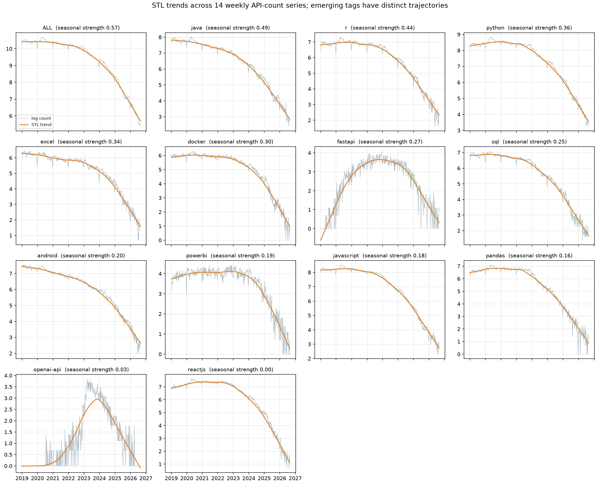
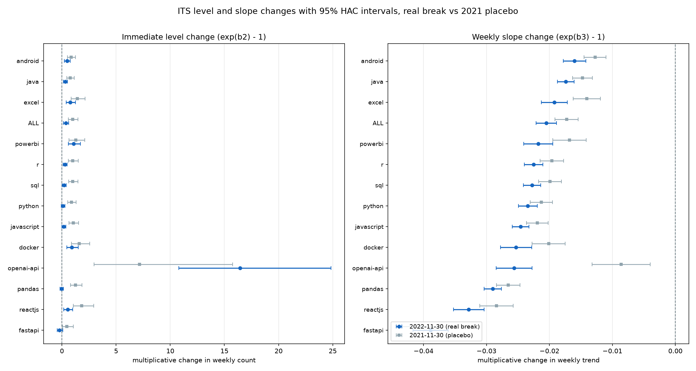
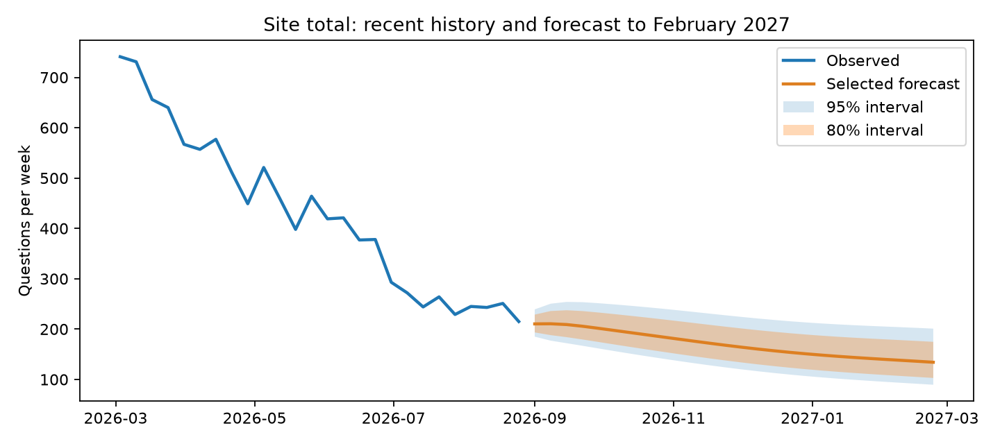
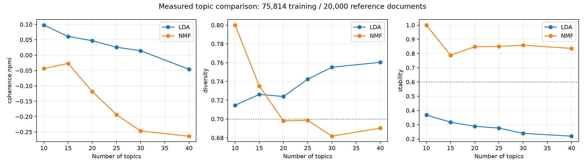
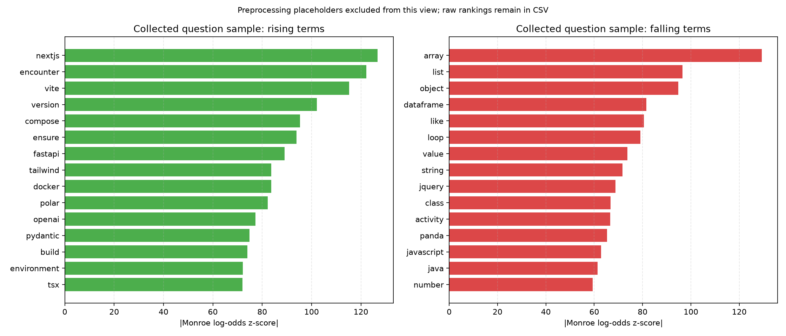
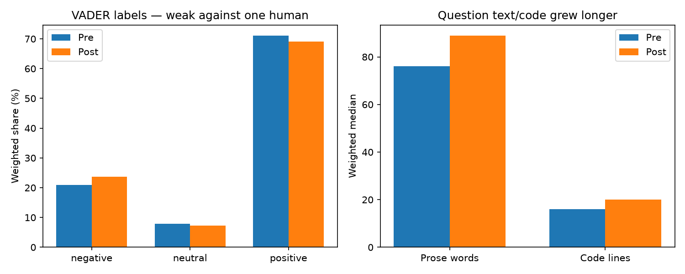

# Stack Overflow in the AI Era: Review 2 final report

**Team:** Abhinav (M1), Rishiikesh (M2), Akshay (M3), Nishanth (M4), Adhikkesh (M5). **Scope:** RQ4 (topics and complexity) and RQ5 (technology forecasting). All numbers are generated from `reports/review2/` by `src/review2_final_report.py`.

## 1. Executive summary

- **Patterns and the 2022 break.** Trend dominates every series. On the log scale, all 14 series show a significant negative change in weekly growth after 2022-11-30 (ITS slope change -3.89% to -1.60% per week, 95% CI excluding zero), and the real break exceeds the 2021-11-30 placebo in 13 of 14 series.
- **Forecasts.** The 26-week site total is forecast to fall from 215 to 134 questions per week by February 2027 (-37.6%), with 6 tags classed steep decline and 5 declining under the fixed thresholds.
- **Topics.** NMF k=15 is selected by the written rule (document-NPMI -0.0270, diversity 0.735, stability 0.788). These are observed topic-share changes: Docker containers and images rises +1.3 pp while Arrays and object manipulation falls -1.8 pp.
- **Tone and complexity.** Questions are longer (+13 prose words) and more code-heavy (+4 code lines) after the break. Tone measures are exploratory: the frustration lexicon moves only -0.2 pp.
- **Recommendations.** Six combined recommendations follow, each citing one time-series and one text-mining number; the proposals are to test workload review, documentation and expert routing, with success measured prospectively.

## 2. Data recap — Unit 1

The final cleaned dataset has **302,026 unique questions and 39 columns**. Validation passes all eight checks: unique IDs, complete required fields, finite positive weights, binary primary and secondary targets, resolved implies answered, study dates and nonnegative account ages. Missing account ages are imputed and flagged (6,319); 302 surviving long bodies carry truncation flags. `dataset/final_dataset_sample.csv` provides 40 title-only linked examples; `dataset/dataset_schema.csv` and `docs/data_dictionary.md` supply schema and definitions. The full cleaned parquet is supplied separately with its SHA-256 in `dataset/dataset_validation.json`.

### Unit 2 predictive-model recap

Train ends before January 2025, validation is January–June 2025 and the locked classifier test is July 2025–July 2026. August 2026 is outside that locked evaluation but included in Unit 3; training-only feature preprocessing and lagged history are used. Validation PR-AUC is majority class 0.3405; logistic regression 0.4707; random forest 0.4734; xgboost 0.4821. Validation selects XGBoost and fixes threshold 0.3669. On the locked 16,695-question test set, PR-AUC is 0.4315, ROC-AUC 0.6548, F1 0.4933, precision 0.3626 and recall 0.7712. These are modest predictive results; no >80% primary-target claim is made. Saved source values are in `reports/review1/m5/results.json`, and the complete notebook displays the comparisons. The easier any-answer target is reported separately.

- **Volume series.** The 302,026-question cleaned sample is paired with a separately collected weekly series of 14 groups (ALL plus 13 study tags) x 400 complete Tuesday-start weeks, 2019-01-01 to 2026-08-25, with no missing weeks. These weekly volumes are separately collected API totals (ALL is site-wide), not counts aggregated from the 302,026 sampled question records. Weighted question-sample rates and API volumes are kept separate.
- **Rate series.** `data/processed/monthly_tag_tables.csv` holds the weighted monthly resolved rate, answered rate and median hours per tag. Months flagged `low_sample` are excluded from conclusions.
- **Text.** 302,026 questions; 165,887 distinct terms after cleaning; code removed from the prose field.
- **Weighting.** Question-sample shares and rates retain their sampling weights (up to 23 before 2025; later weights are 1). Separate API weekly totals are not survey-weighted.
- **Periods.** Pre-AI 2019-01 to 2022-10, transition 2022-11 to 2022-12, post-AI 2023-01 to 2026-08. Event markers: GitHub Copilot GA (2022-06-21); ChatGPT Launch (2022-11-30); Stack Overflow ChatGPT Ban (2022-12-05); Stack Overflow Moderator Strike (2023-06-05).

## 3. Method 1: time series

**Preparation and implementation.** STL (robust, period 52) was fit to each log1p weekly count; the additive components satisfy trend + seasonal + residual = log count. Stationarity was tested with ADF (regression c, AIC) and KPSS on the level and the first difference, under a written verdict rule. Change points were found with `ruptures` PELT (l2 cost, minimum segment 26 weeks) and a BIC penalty fixed in advance, then compared with the four dated events. Interrupted time series were fit per series as segmented regressions of log count on week, a step at 2022-11-30 and a post-break slope, with two Fourier pairs, using OLS with Newey-West HAC errors (lag 4) and a 2021-11-30 placebo.

**Evaluation and interpretation.**

- **Seasonality is secondary.** Trend strength runs 0.86 to 1.00; seasonal strength runs 0.00 to 0.57. Yearly dips cluster in the late-December/January holiday weeks.
- **One difference is justified.** All 14 level series are non-stationary (ADF cannot reject a unit root, KPSS rejects stationarity), so every series is first-differenced (`d=1`), consistent with the M5 SARIMAX backtest. The first-difference tests conflict for 12 series and are reported as such, not hidden.
- **Break-date associations.** The 134 detected breaks are penalised mean shifts, not significance tests: 6 fall within four weeks of a dated event, across 4 series (`java`, `r`, `openai-api`, `sql`). The interrupted time series is sharper: all 14 series show a significant negative post-break slope, -3.89% to -1.60% per week, and the real effect exceeds the placebo in 13 of 14 series. 10 series also show a significant immediate level change, large for `openai-api` (+1645%), which is a step, not a stable trend.
- **Forecast skill is earned at long horizons, not short.** On the 2025-26 rolling-origin backtest, SARIMAX's mean 26-week skill against naive is 55.9% while true 95% coverage is 52.0% (intervals too narrow). At one week ahead the best model reaches 15.7% skill and drift only 0.4%, so the naive baseline remains hard to beat over a single week, as expected.
- **Classes and business reading.** Under the fixed thresholds (5 declining, 2 not classifiable: zero baseline, 6 steep decline), the site total is forecast from 215 to 134 questions per week by February 2027 (-37.6%). `tag_classes.csv` adds a half-life and a 2025 index; zero-baseline tags cannot support a percentage class and are labelled as such.







## 4. Method 2: text mining

**Preparation and implementation.** The corpus of 302,026 questions was lowercased, lemmatised with spaCy and stripped of code, with technical words protected and stopwords and VADER overrides written down. NMF used TF-IDF and LDA used counts over the same unigram/bigram vocabulary and stratified training IDs, with 36 actual fits compared across six k values and three seeds under a rule fixed in advance (highest coherence among candidates with diversity at least 0.7 and stability at least 0.6). Tone used VADER plus a frustration and politeness lexicon; complexity measured prose length, code lines, code blocks, reading ease and structural flags. Shares and rates before 2025 are weighted.

**Evaluation and interpretation.**

- **Measured selection: NMF k=15.** Exact document-cooccurrence NPMI -0.0270, diversity 0.735, stability 0.788. Both families use 75,814 training questions and a disjoint 20,000-question reference. Document NPMI replaces sliding-window c_npmi; this protocol change is disclosed in `docs/review2_topic_evaluation.md`. Per-seed timing, iterations and warnings are retained; 0 fit runs emitted warnings.
- **Semantic-quality limit.** The selected document-NPMI may be low or negative despite satisfying diversity/stability thresholds. Threshold selection does not establish strong semantic validity. Mixed numerical and screenshot-boilerplate topics are flagged; automatic names and recommendations remain exploratory.
- **Largest observed share decreases.** The largest falling topics are Arrays and object manipulation (-1.8 pp), Collections and programming operations (-1.7 pp), Dataframe rows and columns (-1.0 pp); destination traffic was not measured.
- **Largest observed share increases.** The largest rising topics are Docker containers and images (+1.3 pp), Android development and builds (+1.1 pp), API requests and responses (+0.9 pp); the top rising topic resolves only 32.0% within seven days, the resolution bottleneck behind the expert-routing recommendation.
- **Vocabulary shift.** Rising terms include nextjs (z=127), encounter (z=122), vite (z=115), version (z=102), compose (z=95); falling terms include array (z=-129), list (z=-97), object (z=-95), dataframe (z=-82), like (z=-81) (Monroe log-odds with a Dirichlet prior).
- **Tone and complexity.** Negative tone share changed +2.7 pp and positive share -2.0 pp; the frustration flag changed -0.2 pp and is a lexicon measure, not verified emotion. Weighted median prose length changed +13 words and code lines +4, while questions spanning two or more study tags changed -3.4 pp.







**Disclosed AI-assisted validation:** VADER was scored against all 200 existing M3 human labels: accuracy 36.0%, macro-F1 0.344. Separately, Codex AI annotations agreed with M3 on 58.0% of posts (human–AI Cohen's kappa 0.214). This is one human plus an AI, not two independent human raters or an adjudicated gold standard. VADER is weak against this reference; frustration flags remain the primary exploratory tone proxy. Current topic names are automatic descriptions from the corrected model; old AI topic-name proposals are archived and do not validate the new topic IDs. The original human M2 labels, two-human kappa and human topic-naming agreement remain unavailable.

## 5. Combined insights and recommendations

Each recommendation below needs both methods at once and cites at least one time-series and one text-mining number. Every number is read from `reports/review2/`; the machine-readable matrix is `insight_matrix.csv`.

**1. Review workload by tag before changing resource allocation.**

- *Time series:* 6/13 study tags meet the fixed steep-decline forecast threshold; ALL changes -37.6% at 26 weeks.
- *Text mining:* Global frustration-phrase share changes -0.21 pp (95% CI -0.46 to +0.04).
- *Action:* Compare question counts, queue age and observed moderation workload monthly; pilot allocation changes only after measuring demand.
- *Stakeholder:* Q&A platform product team  |  *KPI:* Queue age and moderation hours per 1,000 questions
- *Caveat:* No staffing or effort data were collected; declining traffic does not itself imply less moderation demand.

**2. Test documentation topics suggested by changing vocabulary.**

- *Time series:* ALL validation-selected 26-week forecast is 134.2 questions/week versus 215 last observed.
- *Text mining:* Top global rising keywords: nextjs (z=126.7); encounter (z=122.2); vite (z=115.2).
- *Action:* Inspect linked questions for these keywords and trial a documentation guide with an explicit success measure.
- *Stakeholder:* DevRel teams  |  *KPI:* Guide use and repeat-question share before/after a controlled pilot
- *Caveat:* Keyword shifts are proxies, may reflect technical-token artifacts and do not establish documentation need.

**3. Pilot expert routing for a growing topic and measure resolution.**

- *Time series:* Python ITS growth-rate shift is -2.34%/week after the fixed launch boundary.
- *Text mining:* Docker containers and images: global share +1.28 pp; dominant-topic 7-day resolution 32.0% (n=8,598).
- *Action:* Use a small expert-routing pilot and compare outcomes against a contemporaneous control queue.
- *Stakeholder:* developer-forum managers  |  *KPI:* 7-day resolution and median first-answer hours in pilot versus control
- *Caveat:* Automatic topic labels are provisional. A gain in global share does not demonstrate difficulty or migration from AI tools.

**4. Evaluate a clearer question template as an experiment.**

- *Time series:* ALL projected 26-week volume change is -37.6%; no intervention effect is estimated.
- *Text mining:* Global weighted median prose changes +13 words and code +4 lines.
- *Action:* Trial prompts for expected behaviour, minimal code and version details, with a control group.
- *Stakeholder:* Q&A platform product team  |  *KPI:* Completion rate, question edits and 7-day resolution under random assignment
- *Caveat:* Longer text is not proof of greater difficulty. VADER and frustration flags are weak exploratory signals and should not gate users.

**5. Audit forecast calibration before setting automatic alerts.**

- *Time series:* SARIMAX 26-week matched-origin 95% coverage is 52.0%; skill versus naive is 55.9%.
- *Text mining:* Arrays and object manipulation shows a global topic-share change of -1.80 pp.
- *Action:* Track live forecast errors and recalibrate intervals before using them as operational alert thresholds.
- *Stakeholder:* Q&A platform product team  |  *KPI:* Rolling 80/95% interval coverage and false-alert rate
- *Caveat:* Current intervals under-cover; their nominal label must not be interpreted as verified reliability.

**6. Monitor emerging tags without percentage classes from a zero baseline.**

- *Time series:* openai-api ITS level shift +1644.9%; growth-rate shift -2.56%/week; class: not classifiable: zero baseline.
- *Text mining:* openai-api within-tag topics: API requests and responses (+9.66 pp); SQL queries and tables (+1.35 pp); Android development and builds (+1.05 pp).
- *Action:* Review absolute counts and linked topic examples monthly before proposing specialist routing.
- *Stakeholder:* developer-forum managers  |  *KPI:* Absolute weekly questions and tag-specific resolution rate
- *Caveat:* Sparse tags and automatic labels make interpretation uncertain; a level step is not a sustained growth trend.


## 6. Dashboard guide

The Streamlit/Plotly dashboard originated with M1 and now has seven pages. Observation controls filter charts; model statistics retain fixed fitting periods. Forecast wording follows the selected scenario. Recommendations uses the selected tag and stakeholder to suggest untested pilots with evidence, owners and KPIs. Page 7 adds dataset and locked classifier evidence.

| Page | Owner | Reads |
|---|---|---|
| 1. Overview | M1 | `ts/series_long.csv`, `data/processed/monthly_tag_tables.csv` |
| 2. Patterns and the 2022 break | M3 | `ts/stl_components.csv`, `ts/changepoints.csv`, `ts/its_results.csv` |
| 3. Forecasts | M5 | `ts/forecasts_26w.csv`, `ts/backtest_*.csv`, `ts/tag_classes.csv` |
| 4. Topics | M4 | `text/topics_top_terms.csv`, `text/topic_monthly_share.csv`, `text/topic_prepost.csv`, `text/topic_outcomes.csv` |
| 5. Tone and complexity | M2 | `text/tone_*.csv`, `text/complexity_*.csv`, `text/keywords_prepost.csv` |
| 6. Recommendations | M3 and final corrections | `recommendations.csv`, `insight_matrix.csv`, deterministic pilot rules |
| 7. Dataset and classification | Corrections integration | sanitized dataset preview, validation, locked classifier metrics |

- **Public link:** https://stackoverflow-ai-era.streamlit.app/ (public pages inspected 19 October 2026; redeploy final local corrections before presenting). Local fallback: streamlit run dashboard/app.py
- **Screenshots:** reports/review2/dashboard_screenshots/ (captured from the local application)

Questions show titles only, each linked to `https://stackoverflow.com/q/<id>`, with a CC BY-SA 4.0 licence notice. No bodies and no user hashes are shown.

## 7. Limitations

1. **Weights before 2025.** Sampling weights apply only before 2025; later counts are unweighted.
2. **Thirteen tags.** Only the 13 study tags plus ALL are covered, so the picture is not the whole site.
3. **Resolution is a proxy.** The answer accepted in the collected record was posted within 168 hours. Acceptance-event time is unavailable, so this does not establish acceptance within seven days or asker satisfaction.
4. **VADER is general purpose.** The tone model is a general lexicon with overrides; the frustration flag is exploratory and VADER achieves only 36% accuracy against one human reference; the separate frustration lexicon is not independently validated.
5. **Language scope.** Topic modelling removes code and uses English-oriented lemmatisation/character cleaning; there is no validated language-identification stage. Reliability on multilingual prose is not established.
6. **Forecasts during a steep decline are uncertain.** SARIMAX 95% intervals covered only 52.0% of endpoints, and 10 fits failed.
7. **Association, not cause.** Every result is associated with or consistent with AI-adoption timing; causal attribution is not established. The pre/post boundary is a comparison date, and the placebo break is included for honesty.
8. **Protocol deviations.** Two-human tone adjudication and independent human topic naming were not completed. AI assistance and automatic names are disclosed. Topic coherence uses document cooccurrence rather than the original sliding-window plan.

## 8. How to reproduce

For the saved application, install `dashboard/requirements.txt` and run `streamlit run dashboard/app.py`. No API key or full parquet is needed. For heavy analyses, restore the local inputs described in `docs/review2_submission_guide.md` and install the root requirements. Preserve the original human label sheet.

```bash
python -m src.ts_patterns --task all
python -m src.ts_forecast
python -m src.topics
python -m src.keywords
python -m src.review2_validation
python -m src.review2_dataset
python -m src.review2_m3_insights
python -m src.review2_refresh_evidence
python -m src.export_dashboard_data
python -m src.review2_notebooks
python -m src.review2_final_report
```

The complete submission notebook is `notebooks/review2_main.ipynb`; method notebooks are `07_timeseries.ipynb` and `08_text_mining.ipynb`. Execute them with Jupyter after rebuilding their sources. Existing classifier test results remain locked. Model training writes the source CSVs; downstream refresh/export commands are required to update the notebook, report and app consistently. The submission guide records full-data availability and evaluator package checksums.

## 9. Contributions and board link

| Member | Role | Summary |
|---|---|---|
| M1 Abhinav | Dashboard, final notebook, repo and board | `reports/review2/contribution_member1.md` |
| M2 Rishiikesh | Corpus, tone, complexity | `reports/review2/contribution_member2.md` |
| M3 Akshay | Patterns, ITS, combined insights, final report, deck | `reports/review2/contribution_member3.md` |
| M4 Nishanth | Topics, keyword shift, evaluation | `reports/review2/contribution_member4.md` |
| M5 Adhikkesh | Forecasts, backtest, tag classes | `reports/review2/contribution_member5.md` |

- **Board:** https://github.com/users/Abhinav-Gopalakrishnan/projects/3
- **Repository:** https://github.com/Abhinav-Gopalakrishnan/stackoverflow-ai-era
- **Kaggle notebook:** Not published; source notebooks and local application supplied
